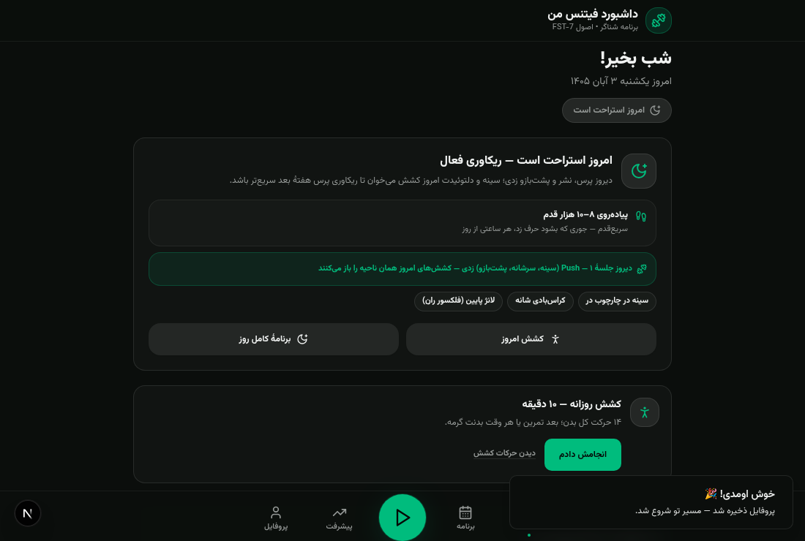
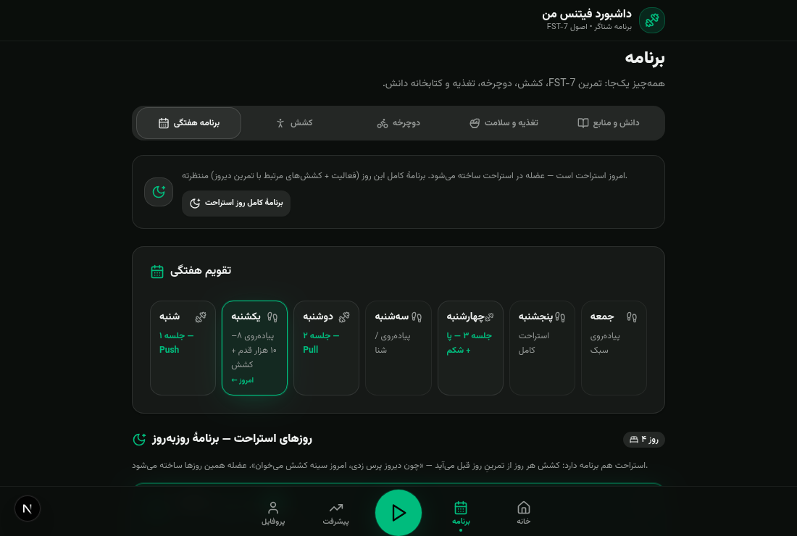
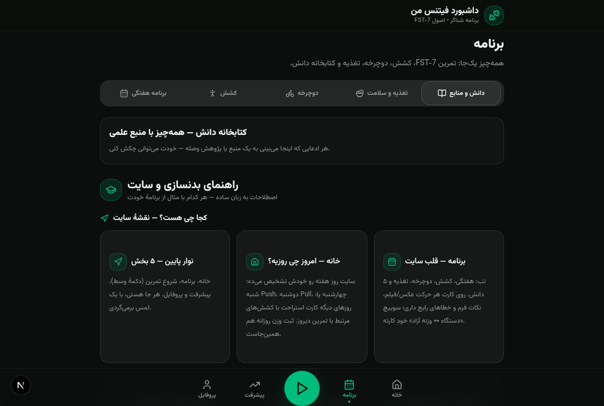
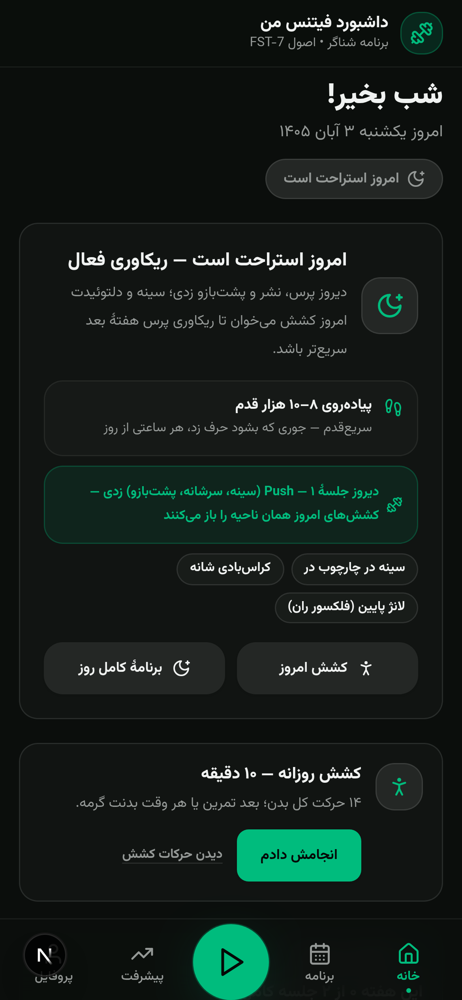
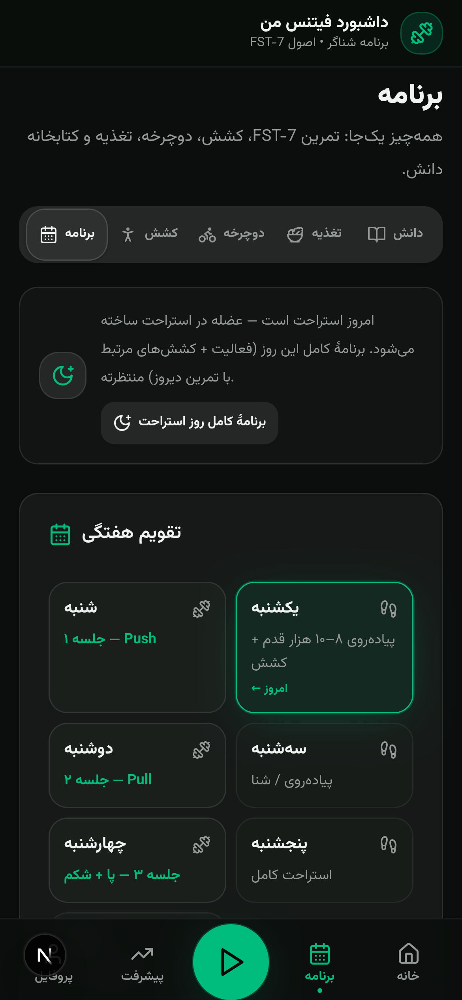
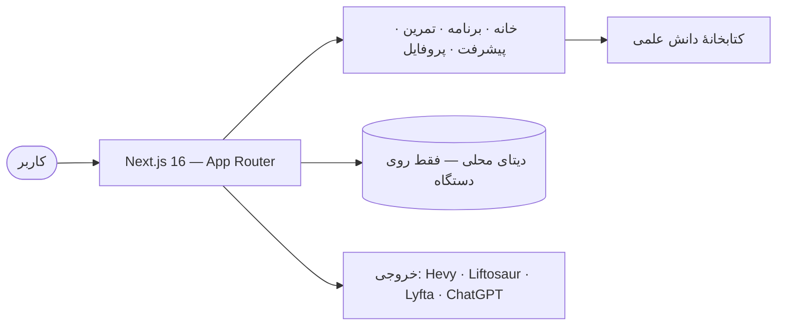

<div align="center">



[](https://cheginisoroush.github.io/Workout/)
[](https://github.com/CheginiSoroush/Workout/actions/workflows/deploy-pages.yml)
[](https://github.com/CheginiSoroush)
[](mailto:imsorouschegini@gmail.com)


**ساختهٔ [سروش چگینی (Soroush)](https://github.com/CheginiSoroush) — برای خودش، بر پایهٔ اصول هانی رامبد (FST-7)**

[🌐 سایت زنده](https://cheginisoroush.github.io/Workout/) · [imsoroush.ir](https://imsoroush.ir) · [پرتفولیو گیت‌هاب](https://github.com/CheginiSoroush)

</div>

---

## ✨ این چیه؟ / What is this?

داشبورد شخصی تمرین، تغذیه و پیشرفت — برنامهٔ **۳ روزهٔ Push / Pull / Legs** با فینیشر **FST-7** در پایان هر جلسه، RPE ۸–۹ و پیشروی دوگانه. همه‌چیز RTL و فارسی، همه‌داده‌ها فقط روی دستگاه خودت، و خروجی مستقیم برای اپ‌های بدنسازی.

> A personal, fully-RTL fitness dashboard: a 3-day PPL split with FST-7 finishers, set-by-set logging, science-backed knowledge base, and one-click exports to Hevy / Liftosaur / Lyfta.

## 🖼️ نگاهی به داخل / Screenshots

| خانه | برنامهٔ هفتگی | دانش و منابع |
|:---:|:---:|:---:|
|  |  |  |
| **موبایل — خانه** | **موبایل — برنامه** | |
|  |  | |

## 🏋️ برنامهٔ تمرین / The Program

| جلسه | تمرکز | ست‌های کاری | فینیشر FST-7 |
|:---:|:---|:---:|:---|
| **شنبه** | سینه · سرشانه · پشت‌بازو | ۲۳ ست | نشر جانب کابل — ۷ ست × ۴۵ ثانیه |
| **دوشنبه** | زیربغل · پشت بازو جلوی بدن | ۲۶ ست | فییس‌پول — ۷ ست × ۴۵ ثانیه |
| **چهارشنبه** | پا · باسن · شکم | ۲۷ ست | نشر جانب دستگاه — ۷ ست × ۴۵ ثانیه |

هر ۲۰ حرکت با ویدیو/فلیپ‌بوک، نکات فرم، خطاهای رایج و **نسخهٔ دستگاه ↔ وزنهٔ آزاد**.

## 🚀 قابلیت‌ها / Features

- 📋 **ثبت جلسه ست‌به‌ست** — وزنه، تکرار، استراحت‌سنج و RPE با دکمه‌های سریع
- 📈 **پیشرفت واقعی** — نمودار وزنه‌ها، استمراری هفتگی و رکوردهای شخصی
- 🧠 **کتابخانهٔ دانش** — قاموس ۳۱ اصطلاح، تحقیق کراتین و CLA، منابع علمی لینک‌دار
- 🧘 **روتین کشش ۱۴ حرکته** + LISS دوچرخه + تغذیه و سلامت
- 📤 **خروجی برای اپ‌ها** — Hevy، Liftosaur، Lyfta، Gymverse و… با نام دقیق حرکت‌ها از کتابخانهٔ هر اپ
- 🤖 **پرامپت ChatGPT + Hevy** — ساخت خودکار هر ۳ روال داخل اپ با یک پرامپت (دستگاهی/آزاد)
- 🔒 **حریم خصوصی کامل** — بدون سرور و حساب؛ همه‌چیز روی دستگاه تو
- 🌓 **تم تیرهٔ سبز** — طراحی mobile-first با فونت وزیرمتن، کاملاً آفلاین

## 📤 خروجی‌ها / Exports

فایل‌های آماده در [`public/exports`](public/exports): `build-hevy*.txt` · `liftosaur-*.liftoscript` · `build-lyfta*.txt` · `chatgpt-hevy-prompt-*.txt` و…

## ⚙️ معماری / Architecture



## 🛠️ تکنولوژی / Tech Stack

| لایه | ابزار |
|:---|:---|
| فریم‌ورک | Next.js 16 (App Router) · React 19 |
| زبان | TypeScript 5 (strict) |
| استایل | Tailwind CSS 4 · shadcn/ui · Lucide |
| داده | Prisma + SQLite · TanStack Query · Zustand |
| اجرا | Bun · GitHub Actions → GitHub Pages |

## 🏃 اجرا / Getting Started

```bash
git clone https://github.com/CheginiSoroush/Workout.git
cd Workout
bun install
bun run dev            # توسعه → http://localhost:3000
bun run build:static   # خروجی استاتیک برای GitHub Pages
```

## 👤 سازنده / Creator

| | |
|:---|:---|
| **طراحی، کد، برنامهٔ تمرینی و محتوا** | سروش چگینی — **Soroush Chegini** |
| **گیت‌هاب** | [@CheginiSoroush](https://github.com/CheginiSoroush) |
| **ایمیل** | [imsorouschegini@gmail.com](mailto:imsorouschegini@gmail.com) |
| **وب‌سایت** | [imsoroush.ir](https://imsoroush.ir) |

---

<div align="center">

© ۲۰۲۶ [Soroush Chegini](https://github.com/CheginiSoroush) — تمام حقوق محفوظ است.

⭐ اگه ایده‌ات را زد، یک ستار بزن!

</div>
