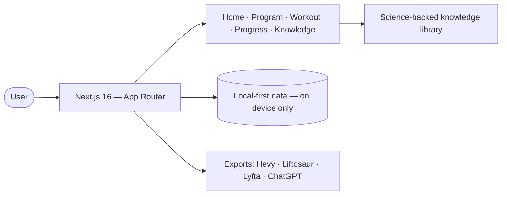

<div align="center">


# FST-7 Swim Physique Dashboard

**A personal, fully-RTL fitness dashboard — a 3-day Push / Pull / Legs split with FST-7 finishers, set-by-set logging, a science-backed knowledge base, and one-click exports to workout apps.**

[](https://cheginisoroush.github.io/Workout/)
[](https://github.com/CheginiSoroush/Workout/actions/workflows/deploy-pages.yml)
[](https://github.com/CheginiSoroush)


[🌐 Live Site](https://cheginisoroush.github.io/Workout/) · [Portfolio](https://imsoroush.ir) · [GitHub Profile](https://github.com/CheginiSoroush)

</div>

---

## ✨ What is this?

A self-hosted training companion built around the **FST-7** principle (Hany Rambod): a 3-day **Push / Pull / Legs** split, each session ending with a 7-set, 45-second rest-pause finisher. Every exercise ships with machine ↔ free-weight variants, form cues, common mistakes and video references. Everything is **Persian-first (RTL)**, works **100% offline**, and stores data **only on your own device** — no accounts, no servers.

## 📸 Screenshots

| Home | Weekly Program | Knowledge Base |
|:---:|:---:|:---:|
|  |  |  |
| **Mobile — Home** | **Mobile — Program** | |
|  |  | |

## 🏋️ The Program

| Session | Focus | Working Sets | FST-7 Finisher |
|:---:|:---|:---:|:---|
| **Sat** | Chest · Shoulders · Triceps | 23 sets | Cable lateral raise — 7 × 45s |
| **Mon** | Back · Biceps | 26 sets | Face pull — 7 × 45s |
| **Wed** | Legs · Glutes · Abs | 27 sets | Machine lateral raise — 7 × 45s |

All 20 exercises include video/flickbook demos, form cues, common mistakes and a **machine ↔ free-weight switch** (machine-first for beginners, backed by a 2023 meta-analysis).

## 🚀 Features

- 📋 **Set-by-set session logging** — weight, reps, rest timer and RPE with quick-fill buttons
- 📈 **Real progress tracking** — weight charts, weekly consistency, personal records
- 🧠 **Knowledge library** — 31-term glossary, creatine research digest, linked scientific sources
- 🧘 **14-move stretching routine** + LISS bike cardio + nutrition guidance
- 📤 **Export to workout apps** — Hevy, Liftosaur, Lyfta, GymMane, Gymverse and more, with exact per-app exercise names
- 🤖 **ChatGPT + Hevy prompt** — auto-build all 3 routines inside the app with a single prompt
- 🔒 **Privacy by design** — no server, no account; everything stays on your device
- 🌓 **Dark emerald theme** — mobile-first, Vazirmatn font, fully offline-capable

## 📤 Workout App Exports

Ready-made files in [`public/exports`](public/exports): `build-hevy*.txt` · `liftosaur-*.liftoscript` · `build-lyfta*.txt` · `build-gymmane*.txt` · `opengym-plan*.json` · `chatgpt-hevy-prompt-*.txt` · `weekly-routine-full.md`

## 🧠 Architecture



## 🛠️ Tech Stack

| Layer | Tools |
|:---|:---|
| Framework | Next.js 16 (App Router) · React 19 |
| Language | TypeScript 5 (strict) |
| Styling | Tailwind CSS 4 · shadcn/ui · Lucide |
| Data | Prisma + SQLite · TanStack Query · Zustand |
| Runtime | Bun · GitHub Actions → GitHub Pages |

## ⚡ Getting Started

```bash
git clone https://github.com/CheginiSoroush/Workout.git
cd Workout
bun install
bun run dev            # develop → http://localhost:3000
bun run build:static   # static build for GitHub Pages
```

## 👤 Author

| | |
|:---|:---|
| **Design, code, training program & content** | Soroush Chegini |
| **GitHub** | [@CheginiSoroush](https://github.com/CheginiSoroush) |
| **Email** | [imsorouschegini@gmail.com](mailto:imsorouschegini@gmail.com) |
| **Website** | [imsoroush.ir](https://imsoroush.ir) |

---

## 🇮🇷 نسخهٔ فارسی

<details>
<summary><b>مشاهدهٔ نسخهٔ فارسی — کلیک کنید</b></summary>

### ✨ این چیه؟

داشبورد شخصی تمرین بر پایهٔ اصل **FST-7** (هانی رامبد): برنامهٔ ۳ روزهٔ **Push / Pull / Legs** که هر جلسه با فینیشر ۷ ست × ۴۵ ثانیه تمام می‌شود. هر ۲۰ حرکت نسخهٔ **دستگاه ↔ وزنهٔ آزاد**، نکات فرم، خطاهای رایج و ویدیو دارد. همه‌چیز فارسی و RTL، کاملاً آفلاین، و داده‌ها فقط روی دستگاه خودت — بدون سرور و حساب کاربری.

### 🏋️ برنامه

| جلسه | تمرکز | ست‌های کاری | فینیشر FST-7 |
|:---:|:---|:---:|:---|
| **شنبه** | سینه · سرشانه · پشت‌بازو | ۲۳ ست | نشر جانب کابل — ۷ × ۴۵ث |
| **دوشنبه** | زیربغل · جلوبازو | ۲۶ ست | فییس‌پول — ۷ × ۴۵ث |
| **چهارشنبه** | پا · باسن · شکم | ۲۷ ست | نشر جانب دستگاه — ۷ × ۴۵ث |

### 🚀 قابلیت‌ها

- 📋 ثبت جلسه ست‌به‌ست — وزنه، تکرار، استراحت‌سنج و RPE
- 📈 نمودار وزنه‌ها، استمراری هفتگی و رکوردهای شخصی
- 🧠 کتابخانهٔ دانش — قاموس ۳۱ اصطلاح، تحقیق کراتین، منابع علمی لینک‌دار
- 🧘 روتین کشش ۱۴ حرکته + LISS دوچرخه + تغذیه
- 📤 خروجی برای Hevy، Liftosaur، Lyfta، GymMane و… با نام دقیق حرکت‌ها
- 🤖 پرامپت ChatGPT + Hevy برای ساخت خودکار هر ۳ روال
- 🔒 حریم خصوصی کامل — همه‌چیز روی دستگاه تو
- 🌓 تم تیرهٔ سبز، فونت وزیرمتن، mobile-first

### 🏃 اجرا

```bash
git clone https://github.com/CheginiSoroush/Workout.git
cd Workout
bun install
bun run dev            # توسعه → http://localhost:3000
bun run build:static   # خروجی استاتیک برای GitHub Pages
```

### 👤 سازنده

**سروش چگینی — Soroush Chegini** · [@CheginiSoroush](https://github.com/CheginiSoroush) · [imsorouschegini@gmail.com](mailto:imsorouschegini@gmail.com) · [imsoroush.ir](https://imsoroush.ir)

</details>

---

<div align="center">

© 2026 [Soroush Chegini](https://github.com/CheginiSoroush) — All rights reserved. / تمام حقوق محفوظ است.

⭐ If this project gave you an idea, give it a star!

</div>
